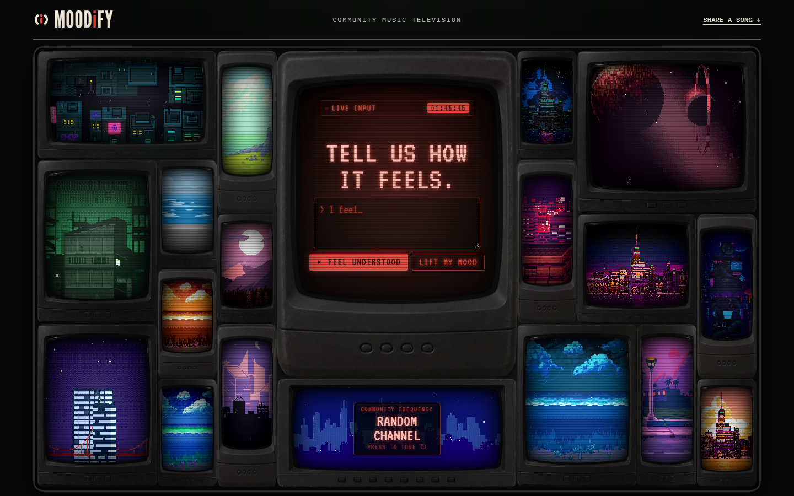
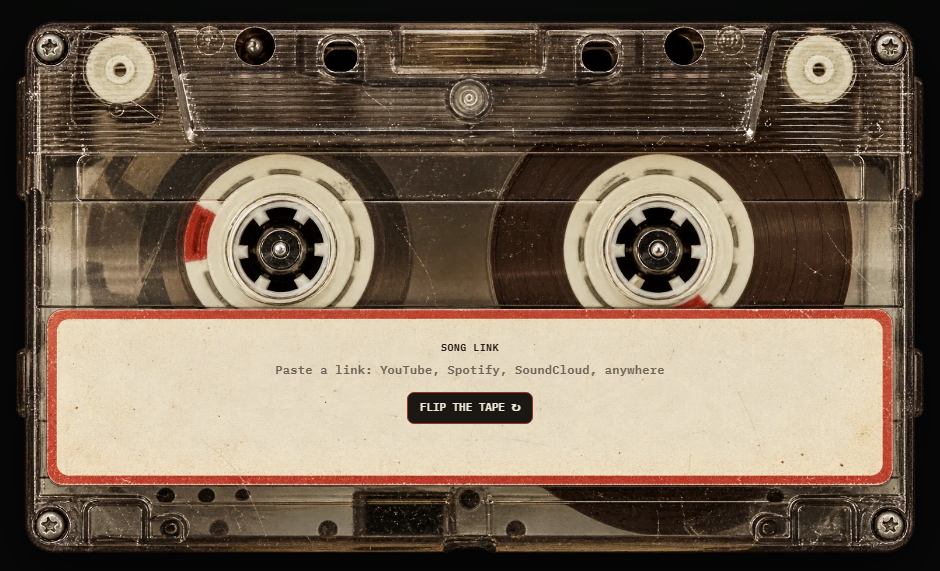

# MoodIfy

[](https://github.com/eshitakundu/MoodIfy/actions/workflows/ci.yml)

**Tell it how you feel. Get back a song someone shared for that feeling, and the note they left for you.**

Live at **[moodify.eshita.dev](https://moodify.eshita.dev)**

MoodIfy is community music television. People share a song by pasting a link (YouTube, Spotify, SoundCloud or anywhere else), flip the tape and write what the song holds for them. When you describe how you feel, MoodIfy reads your mood and finds the shared song whose note fits your words best. You can ask to *feel understood* (same mood) or to *lift your mood* (a gentler mood one step away).



## How it works

```
your text ──► crisis check ──► mood reader ──► target mood ──► retrieval ──► song + note
                  │              LLM, falls      relate: same     TF-IDF over the
                  │              back to         lift: one step   target mood's
                  ▼              keywords        toward calm      notes, skips seen
          support message
          (never sent to a model)
```

1. **Mood reader.** An OpenRouter model labels the text with one of nine moods (joyful, sad, anxious, angry, lonely, drained, nostalgic, calm, hopeful). Its answer is checked against that fixed list. No key, a timeout, bad JSON or an unknown label all fall back to an offline keyword reader, so the app always answers.
2. **Retrieval.** Songs are filtered to the target mood, then ranked by TF-IDF cosine similarity between your text and each note. "Can't sleep, mind racing at 2am" finds the note written about 2am anxiety, not just any anxious song. Community songs win ties over starter ones, and you won't see the same one twice until the pool runs out.
3. **Safety first.** Text that mentions self-harm or suicide is never sent to a model. The response leads with a support message and free helplines (Tele-MANAS 14416 in India, findahelpline.com elsewhere).

## Sharing a song



Side A takes the link, side B the message and an optional name. The link is checked before anything is saved: https only, no passwords in the URL, no IP addresses or localhost. Known music sites are labelled by name, and anything else shows its domain so people can see where a link goes before clicking it. Titles and artists come from each site's public oEmbed endpoint, so nobody has to type them.

Every message then goes through layered moderation before it can reach the public wall:

| Layer | Catches | If unsure |
|---|---|---|
| Rules (always on) | self-harm language, links or contact details in the message, spam | crisis messages are never posted; the sender gets support resources |
| LLM check | harassment, hate, sexual content, ads, personal information | **held** for review, never published unchecked |
| Rate limit | more than 3 songs an hour or 10 a day per visitor (salted IP hash, no addresses stored) | 429 |
| Maintainer | anything the first three missed | hide or approve through a token-protected admin endpoint |

In production `MOODIFY_REQUIRE_MODERATION=1` holds every message if the model key is missing, rather than falling back to rules only.

### Starter set

A new community app is empty on day one, so MoodIfy ships with **200 starter songs** across all nine moods: Bollywood and Indian indie, K-pop and J-pop, Latin, Afrobeats, French, Pakistani and Brazilian classics, and indie from Mitski to Men I Trust. Each has a short note on when it helps, and they are labelled "MoodIfy starter set" in the API. They are used for matching but never shown on the community wall.

## Evaluation

`python evals/run_eval.py` scores the mood reader on two labelled sets:

| Set | Cases | Offline keyword reader |
|---|---:|---:|
| Direct phrasing ("exam tomorrow and I'm so nervous") | 45 | 100% |
| Indirect phrasing ("refreshing the results page every two minutes") | 18 | 6% |

Read this honestly. I wrote the direct set alongside the keyword list, so 100% there only proves the fallback works on plain language, and CI fails if it drops below 85%. The indirect set is the real test: people rarely name their feelings, and keywords almost never catch that. That gap is what the LLM reader is for. Run `python evals/run_eval.py --llm` with an `OPENROUTER_API_KEY` to score it on the same cases.

## Tests

59 pytest tests cover:
- the starter set and the mood reader, including every LLM failure mode falling back correctly (mocked transport)
- retrieval ranking and repeat-skipping
- crisis handling (asserting the model is never called)
- link safety (schemes, credentials, IPs) and oEmbed lookups
- moderation failing closed
- rate limits, wall pagination and the admin endpoints
- the upgrade from the original database schema

## Run it

```bash
python -m venv .venv
source .venv/bin/activate          # Windows: .venv\Scripts\activate
pip install -e ".[dev]"

uvicorn moodify.app:create_app --factory --reload    # http://localhost:8000
pytest -q
python evals/run_eval.py
```

Optional: set `OPENROUTER_API_KEY` (free at openrouter.ai) to use the LLM reader and moderation, and `MOODIFY_MODEL` to pick a model (default `nvidia/nemotron-3.5-lightning:free`, so it costs nothing to run). Without a key everything still works on the keyword reader and moderation rules.

## Deployment

The site runs on a Cloudflare Python Worker. The same FastAPI app serves `/api/*` through the Worker's ASGI bridge, Workers Assets serve the page in `web/`, and songs live in D1. Locally the app uses SQLite instead; both stores expose the same methods (`src/worker.py` has the D1 one).

```bash
npx wrangler d1 create moodify                         # put the id in wrangler.jsonc
npx wrangler d1 migrations apply moodify --remote      # table + starter songs
npx wrangler secret put OPENROUTER_API_KEY
npx wrangler secret put MOODIFY_ADMIN_TOKEN
npx wrangler secret put MOODIFY_SALT
uv run pywrangler deploy
```

After editing `seeds/starter_capsules.json`, `scripts/make_seed_migration.py <name>` writes the next D1 migration; it only adds songs the database doesn't have. The local SQLite store tops itself up on start.

## API

| Method | Path | What it does |
|---|---|---|
| `POST` | `/api/match` | `{text, mode: "relate" or "lift", seen: [ids]}` returns the reading and a song |
| `POST` | `/api/capsules` | Share a song: `{url, message, name?, title?}`. Returns `visible`, `held` or `crisis` |
| `GET` | `/api/wall?before=<id>&limit=20` | Community notes, newest first |
| `GET` | `/api/capsules?mood=calm` | Songs in one mood |
| `GET` | `/api/moods` | The nine moods |

Interactive docs at `/docs`. Frontend notes are in [docs/frontend-api.md](docs/frontend-api.md).

## Limitations

- The keyword fallback is weak on indirect language (see the eval). With no API key, expect generic matches for subtle text.
- One mood per message. Mixed feelings ("happy but scared") get the stronger signal.
- Moderation is only as good as the model behind it; held messages wait for a person to review them.

## History

Started in March 2025 as a hackathon prototype (Streamlit, MySQL and a UiPath email workflow), which grew out of the capsule idea in [Trackify](https://github.com/eshitakundu/Trackify). Rebuilt in October 2026 as a tested FastAPI service with an LLM mood reader, retrieval and evals, then turned into a community wall with song links, moderation and a TV-wall interface. The earlier commits are still in the history.

The TV wall plays CC0 pixel art from OpenGameArt, animated with parallax, rain and flickering light by `scripts/render_pixel_reel.py`. Artist credits are in [web/media/clips/SOURCES.md](web/media/clips/SOURCES.md).

## Stack

Python · FastAPI · Pydantic · httpx · OpenRouter · SQLite / Cloudflare D1 · Cloudflare Python Workers · vanilla JS · pytest · GitHub Actions
